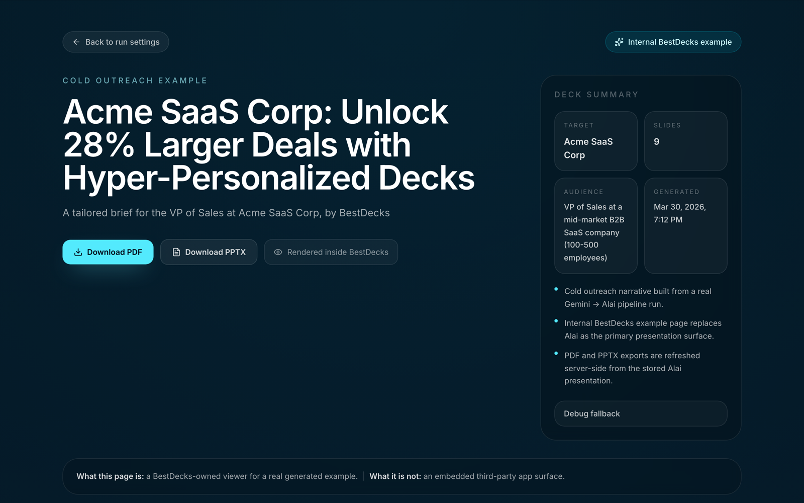

<p align="center">
  
</p>

<h1 align="center">Bestdecks</h1>

<p align="center">
  <strong>Evidence-gated proposal decks.</strong><br>
  Give it your pitch and a list of target companies. It researches each one, drafts a tailored deck, and refuses to ship any factual claim it can't tie to a retained source.
</p>

<p align="center">
  <a href="https://bestdecks.co">Live demo</a> ·
  <a href="#quickstart">Quickstart</a> ·
  <a href="#how-it-works">How it works</a> ·
  <a href="./docs/architecture.md">Architecture</a> ·
  <a href="./docs/self-hosting.md">Self-hosting</a>
</p>

<p align="center">
  <a href="https://github.com/Nadimul96/bestdecks/actions/workflows/ci.yml"></a>
  <a href="./LICENSE"></a>
  
  
  
</p>

---

## Why this exists

Most AI deck generators are fluent and confidently wrong. Bestdecks treats that as a bug to engineer out, not a disclaimer to add.

- **Every factual claim is traceable.** A slide can only be labeled `source_backed` when its text matches, verbatim, a snippet retained from the canonical source URL. Paraphrases fail closed.
- **Unsupported claims block delivery.** The run doesn't finish with a warning. It stops, shows you which claims have no evidence, and waits.
- **Deterministic, not vibes.** Evidence coverage is computed from a typed claim ledger, not a model-generated "quality score." The same inputs produce the same verdict.
- **You own the whole stack.** Self-hosted, Apache-2.0, bring your own API keys. SQLite locally, libSQL/Turso if you want. No hosted account, no billing surface, no telemetry.

## How it works

```
  CSV / TSV / pasted URLs          seller context
          │                     (offer, ICP, outcome)
          ▼                              │
   ┌──────────────┐                      │
   │   intake     │◀─────────────────────┘
   └──────┬───────┘
          ▼
   ┌──────────────┐   Cloudflare Browser Rendering
   │    crawl     │──▶ retained page evidence, keyed by canonical URL
   └──────┬───────┘
          ▼
   ┌──────────────┐   Perplexity
   │   research   │──▶ enrichment, every snippet tied to a source
   └──────┬───────┘
          ▼
   ┌──────────────┐   Gemini
   │ brief + plan │──▶ narrative + slide plan, one of 8 deck archetypes
   └──────┬───────┘
          ▼
   ┌──────────────┐   src/domain/evidence.ts
   │ evidence gate│──▶ claim ledger: source_backed │ seller_supplied │ model_inference │ unsupported
   └──────┬───────┘        └── any `unsupported` claim ⇒ delivery blocked
          ▼
   ┌──────────────┐   self-hosted Presenton, render-only
   │   render     │──▶ native-vector PPTX, OOXML allowlist verified, SHA-256 checked
   └──────┬───────┘
          ▼
   download or scoped read-only share link
```

The web app only accepts and queues runs. A separate **durable worker** claims each run under a lease, checkpoints every stage to SQLite, retries with bounds, and survives restarts. Kill it mid-run and it resumes where it left off.

### What a run produces

Every run ends in a viewer page with PDF and PPTX downloads, a deck summary, and the rendered slides. Below is the checked-in sample run ([live](https://bestdecks.co/examples/cold-outreach)).

<p align="center">
  
</p>
<p align="center">
  
</p>

### What's technically interesting here

| Piece | Where | Why it matters |
| --- | --- | --- |
| Claim-level evidence gate | [`src/domain/evidence.ts`](./src/domain/evidence.ts), [`src/domain/run-receipt.ts`](./src/domain/run-receipt.ts) | Provenance is a containment check against retained text, so it's auditable and reproducible. No LLM-as-judge. |
| Leased SQLite job queue | [`src/server/run-queue.ts`](./src/server/run-queue.ts), [`src/bin/run-worker.ts`](./src/bin/run-worker.ts) | Leases, heartbeats, checkpoints, bounded retries, idempotent dispatch, cancellation. Resumable Cloudflare crawl jobs. |
| Render-only PPTX contract | [`src/integrations/presenton.ts`](./src/integrations/presenton.ts), [`deploy/presenton/`](./deploy/presenton/) | Bestdecks builds every slide's vector UI itself and asks the renderer only to export. Output is verified against an OOXML allowlist (no pictures, media, OLE, external rels). |
| Encrypted per-tenant provider secrets | [`src/server/`](./src/server/) | Integration keys are wrapped with `APP_SECRETS_KEY`, with a transactional re-wrap command for key rotation. |
| Capability inventory as code | [`src/config/capabilities.ts`](./src/config/capabilities.ts) | Every feature's status (`implemented` / `experimental` / `planned`) is a typed constant the UI and docs read from, so the README can't drift from the code. |

## Quickstart

You'll need Node 24.18, pnpm 11.7, Docker (for the renderer), and your own keys for Cloudflare, Perplexity, and Gemini.

```bash
git clone https://github.com/Nadimul96/bestdecks.git
cd bestdecks
pnpm setup                        # writes .env.local with fresh secrets; never overwrites
pnpm install --frozen-lockfile
```

Add `CLOUDFLARE_ACCOUNT_ID`, `CLOUDFLARE_API_TOKEN`, `PERPLEXITY_API_KEY`, and `GEMINI_API_KEY` to `.env.local`, then run the three processes:

```bash
pnpm presenton:start              # digest-pinned renderer, loopback only
pnpm dev                          # web app on http://localhost:3000
BESTDECKS_COMMIT_SHA="$(git rev-parse --short=12 HEAD)" pnpm worker
```

Sign in, fill in your seller context, paste a few target URLs, launch a run. `pnpm doctor` validates your configuration offline before anything is charged.

Full production topology, secret rotation, and the renderer hardening policy are in [docs/self-hosting.md](./docs/self-hosting.md).

## Verify it yourself

```bash
pnpm lint && pnpm typecheck && pnpm test:unit && pnpm build
pnpm check                        # typecheck + validate and plan the checked-in example
```

CI runs lint, typecheck, 484 unit tests, a production build, dependency review, and a full-history secret scan on every push.

## Status

**Public source, pre-production.** The intake, research, planning, evidence gate, durable worker, and render path are implemented and unit-tested. What's not yet checked in is a *reference receipt*: a controlled live run through Cloudflare → Perplexity → Gemini → Presenton with redacted request metadata and artifact checksums. Until that exists, treat generated decks as drafts and review them before sending.

The machine-readable inventory is [`src/config/capabilities.ts`](./src/config/capabilities.ts), and a unit test fails if this table drifts from it. The full gate is in [docs/release-readiness.md](./docs/release-readiness.md).

| Capability | Status | Boundary | Source evidence |
| --- | --- | --- | --- |
| CSV, TSV, and pasted-URL intake | Implemented | OSS core | `src/domain/intake.ts`, `src/domain/schemas.ts` |
| Seller context and eight named deck archetypes | Implemented | OSS core | `src/domain/schemas.ts`, `src/domain/pipeline.ts` |
| Built-in robots-aware HTTPS crawl adapter | Implemented | Provider adapter | `src/integrations/builtin-crawler.ts`, `src/integrations/web-fetcher.ts` |
| Cloudflare Browser Rendering crawl adapter | Implemented | Provider adapter | `src/integrations/cloudflare.ts`, `src/server/reference-providers.ts` |
| First-party site research adapter | Implemented | Provider adapter | `src/integrations/site-research.ts`, `src/server/reference-providers.ts` |
| Perplexity enrichment adapter | Implemented | Provider adapter | `src/integrations/perplexity.ts`, `src/server/reference-providers.ts` |
| Gemini brief and slide planning | Implemented | Provider adapter | `src/server/ai-brief-builder.ts`, `src/server/slide-planner.ts` |
| Claim-level evidence coverage and delivery gate | Implemented | OSS core | `src/domain/evidence.ts`, `src/domain/run-receipt.ts`, `src/server/run-executor.ts` |
| Presenton deterministic rich-static PPTX rendering | Implemented | Provider adapter | `src/integrations/presenton.ts`, `src/server/run-executor.ts` |
| Deepcrawl crawl adapter | Experimental | Provider adapter | `src/integrations/deepcrawl.ts` |
| Gemini image-generation adapter | Experimental | Provider adapter | `src/integrations/gemini.ts` |
| Alai renderer adapter | Experimental | Provider adapter | `src/integrations/alai.ts` |
| Plus AI / Google Slides renderer adapter | Experimental | Provider adapter | `src/integrations/plusai.ts` |
| Outbound email delivery | Planned | OSS core | `ROADMAP.md` |

## Design boundaries

- The renderer is deliberately **vector-only, no generated or remote images**. Predictable, portable, verifiable.
- The public core must stay complete without any hosted service. A future private `bestdecks-cloud` may consume it; it may never be required by it ([ADR 0001](./docs/adr/0001-oss-core-cloud-boundary.md)).
- No email sending until there's an approval, suppression, audit, and idempotency contract ([ROADMAP](./ROADMAP.md)).

## Documentation

[Architecture](./docs/architecture.md) · [Self-hosting](./docs/self-hosting.md) · [Provider notes](./docs/provider-notes.md) · [Release readiness](./docs/release-readiness.md) · [ADRs](./docs/adr/README.md) · [Roadmap](./ROADMAP.md) · [Changelog](./CHANGELOG.md) · [Security](./SECURITY.md) · [Contributing](./CONTRIBUTING.md)

## License

Apache License 2.0. See [LICENSE](./LICENSE).
