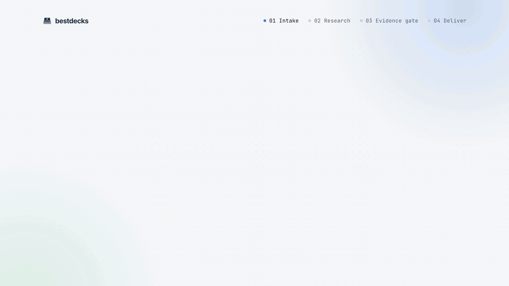
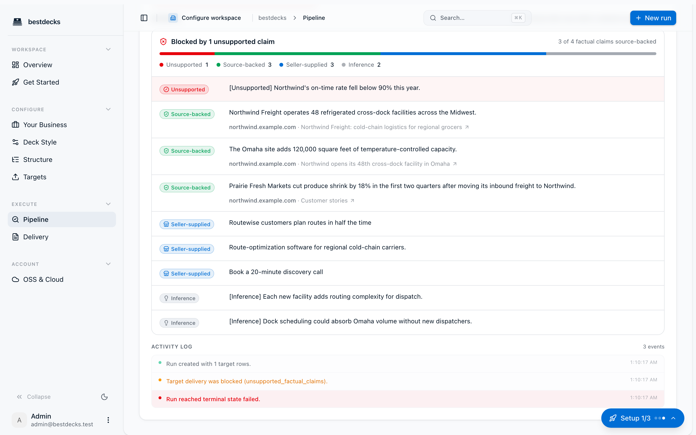
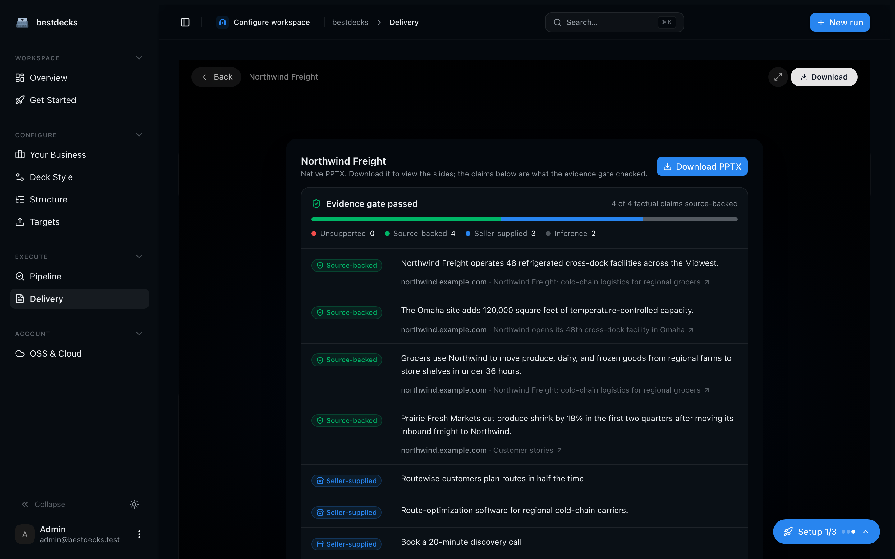
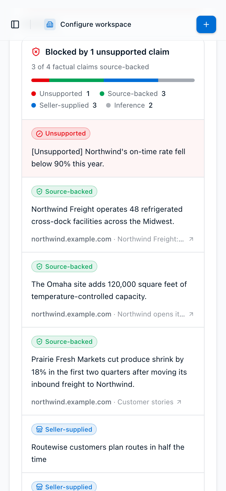
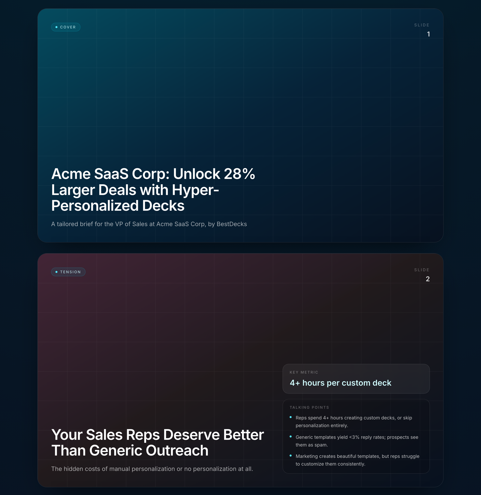

<p align="center">
  
</p>

<h1 align="center">Bestdecks</h1>

<p align="center">
  <strong>Evidence-gated proposal decks.</strong><br>
  Give it your pitch and a list of target companies. It researches each one, drafts a tailored deck, and refuses to ship any factual claim it can't tie to a retained source.<br>
  Self-hosted, Apache-2.0, and the default setup needs one Gemini API key (free tier available).
</p>

<p align="center">
  <a href="https://bestdecks.co">Live demo</a> ·
  <a href="#quickstart">Quickstart</a> ·
  <a href="#how-it-works">How it works</a> ·
  <a href="./docs/architecture.md">Architecture</a> ·
  <a href="./docs/self-hosting.md">Self-hosting</a>
</p>

<p align="center">
  <a href="https://github.com/Nadimul96/bestdecks/actions/workflows/ci.yml"></a>
  <a href="https://github.com/Nadimul96/bestdecks/actions/workflows/e2e.yml"></a>
  <a href="./LICENSE"></a>
  
  
</p>

---

## Why this exists

Most AI deck generators are fluent and confidently wrong. Bestdecks treats that as a bug to engineer out, not a disclaimer to add.

- **Every factual claim is traceable.** A slide can only be labeled `source_backed` when its text matches, verbatim, a snippet retained from the canonical source URL. Paraphrases fail closed.
- **Unsupported claims block delivery.** The run doesn't finish with a warning. It stops, shows you which claims have no evidence, and waits.
- **Deterministic, not vibes.** Evidence coverage is computed from a typed claim ledger, not a model-generated "quality score." The same inputs produce the same verdict.
- **You own the whole stack, for free.** Self-hosted, Apache-2.0. The default path crawls with a built-in, robots.txt-respecting crawler and researches from each company's own pages, so the only key it needs is Gemini's. SQLite locally, no hosted account, no telemetry.

## How it works

```
  CSV / TSV / pasted URLs          seller context
          │                     (offer, ICP, outcome)
          ▼                              │
   ┌──────────────┐                      │
   │   intake     │◀─────────────────────┘
   └──────┬───────┘
          ▼
   ┌──────────────┐   built-in HTTPS crawler (default) or Cloudflare
   │    crawl     │──▶ retained page text, keyed by canonical URL
   └──────┬───────┘
          ▼
   ┌──────────────┐   first-party site research + Gemini (default) or Perplexity
   │   research   │──▶ verbatim passages, every snippet tied to its source URL
   └──────┬───────┘
          ▼
   ┌──────────────┐   Gemini
   │ brief + plan │──▶ narrative + slide plan, one of 8 deck archetypes
   └──────┬───────┘
          ▼
   ┌──────────────┐   src/domain/evidence.ts
   │ evidence gate│──▶ claim ledger: source_backed │ seller_supplied │ model_inference │ unsupported
   └──────┬───────┘        └── any `unsupported` claim ⇒ delivery blocked
          ▼
   ┌──────────────┐   self-hosted Presenton, render-only
   │   render     │──▶ native-vector PPTX, OOXML allowlist verified, SHA-256 checked
   └──────┬───────┘
          ▼
   download or scoped read-only share link
```

The web app only accepts and queues runs. A separate **durable worker** claims each run under a lease, checkpoints every stage to SQLite, retries with bounds, and survives restarts. Kill it mid-run and it resumes where it left off.

### The evidence gate, in the UI

Every run shows the claim ledger the gate evaluated: the verdict, a coverage bar, and each claim with its label and the retained page it cites. One unsupported claim blocks the deck. (Fictional sample company, seeded offline through the real worker with fixture providers.)

<p align="center">
  
</p>

| Delivered deck, dark mode | Phone width |
| --- | --- |
|  |  |

### What a run produces

Decks that pass the gate download as native-vector PPTX. The checked-in example page shows the deck structure ([live](https://bestdecks.co/examples/cold-outreach)).

<p align="center">
  
</p>

### What's technically interesting here

| Piece | Where | Why it matters |
| --- | --- | --- |
| Claim-level evidence gate | [`src/domain/evidence.ts`](./src/domain/evidence.ts), [`src/domain/run-receipt.ts`](./src/domain/run-receipt.ts), [`components/evidence-ledger.tsx`](./components/evidence-ledger.tsx) | Provenance is a containment check against retained text, so it's auditable and reproducible. No LLM-as-judge. The UI renders the same verdict per claim. |
| SSRF-safe built-in crawler | [`src/integrations/web-fetcher.ts`](./src/integrations/web-fetcher.ts), [`src/integrations/robots-txt.ts`](./src/integrations/robots-txt.ts), [`src/integrations/builtin-crawler.ts`](./src/integrations/builtin-crawler.ts) | Every hop (redirects and robots.txt included) is re-validated and DNS-pinned; RFC 9309 robots rules; text extraction only removes markup, so retained sentences stay verbatim. |
| Leased SQLite job queue | [`src/server/run-queue.ts`](./src/server/run-queue.ts), [`src/bin/run-worker.ts`](./src/bin/run-worker.ts) | Leases, heartbeats, checkpoints, bounded retries, idempotent dispatch, cancellation. Resumable Cloudflare crawl jobs. |
| Render-only PPTX contract | [`src/integrations/presenton.ts`](./src/integrations/presenton.ts), [`deploy/presenton/`](./deploy/presenton/) | Bestdecks builds every slide's vector UI itself and asks the renderer only to export. Output is verified against an OOXML allowlist (no pictures, media, OLE, external rels). |
| Encrypted per-tenant provider secrets | [`src/server/`](./src/server/) | Integration keys are wrapped with `APP_SECRETS_KEY`, with a transactional re-wrap command for key rotation. |
| Capability inventory as code | [`src/config/capabilities.ts`](./src/config/capabilities.ts) | Every feature's status (`implemented` / `experimental` / `planned`) is a typed constant the UI and docs read from, so the README can't drift from the code. |

## Quickstart

You need one key: a **Gemini API key**. Crawling, first-party research, and the renderer need no key.

1. Get a free key at [Google AI Studio](https://aistudio.google.com/apikey).
2. Copy the config, paste the key after `GEMINI_API_KEY=`, and start the stack:

   ```bash
   git clone https://github.com/Nadimul96/bestdecks.git && cd bestdecks
   cp .env.example .env      # paste your key after GEMINI_API_KEY=
   docker compose up
   ```

3. Open the URL it prints (http://localhost:3000) and sign in with the email and password it prints.

That's the whole setup. A first-run service generates every secret and the admin password into a private volume and prints the `pnpm doctor` checklist; the stack is the web app (bound to 127.0.0.1), the durable worker, and the digest-pinned Presenton renderer on an internal network ([details](./docs/self-hosting.md#fastest-path-docker-compose)). The [Compose E2E workflow](./.github/workflows/e2e.yml) runs these exact steps on every push, with a placeholder key: it signs in with the printed account, crawls a local fixture site, checks that research stops with a "set GEMINI_API_KEY" message, and renders and verifies a PPTX through the pinned renderer.

**Native (Node 24.18, pnpm 11.7):**

```bash
pnpm setup                        # writes .env.local with fresh secrets; never overwrites
pnpm install --frozen-lockfile
# add GEMINI_API_KEY to .env.local
pnpm doctor                       # offline checklist: says exactly what is missing
pnpm presenton:start              # digest-pinned renderer (needs Docker), loopback only
pnpm dev                          # web app on http://localhost:3000
pnpm worker                       # durable worker, in a second terminal
```

Sign up, fill in your seller context, paste a few target URLs, launch a run. `pnpm smoke:crawl https://example.com/` exercises the built-in crawler live with no key.

## Configuration

Every variable is documented in [`.env.example`](./.env.example). The ones that matter:

| Variable | Required? | Default | What it does |
| --- | --- | --- | --- |
| `GEMINI_API_KEY` | Yes | none | Research summaries, company briefs, and slide plans (Gemini 2.5 Flash). |
| `CRAWL_PROVIDER` | No | `builtin` | `builtin` (free, robots.txt-respecting, no JavaScript rendering) or `cloudflare`. |
| `RESEARCH_PROVIDER` | No | `site` | `site` (the target's own pages and feed, summarized by Gemini) or `perplexity` (external web research, paid). |
| `CLOUDFLARE_ACCOUNT_ID`, `CLOUDFLARE_API_TOKEN` | With `cloudflare` | none | Cloudflare Browser Rendering crawl. |
| `PERPLEXITY_API_KEY` | With `perplexity` | none | Perplexity Sonar enrichment. |
| `ADMIN_EMAIL`, `ADMIN_PASSWORD` | No | `admin@bestdecks.local`, generated | First account, created on first start (production mode disables signup). Compose prints a generated password once. |
| `BETTER_AUTH_SECRET`, `APP_SECRETS_KEY` | Yes | generated | Auth signing and secret-encryption keys; `pnpm setup` and Compose generate them. |
| `PRESENTON_BASE_URL`, `PRESENTON_AUTH_USERNAME`, `PRESENTON_AUTH_PASSWORD` | Yes | set by setup/Compose | The self-hosted renderer. |
| `ALLOW_SHARED_PROVIDER_CREDENTIALS` | No | `1` in `.env.example` | Lets signed-in users run with the keys in your env file. Use `0` for multi-user hosting. |
| `BESTDECKS_COMMIT_SHA` | Worker | set by setup/Compose | Source commit recorded in every run receipt. |
| `LOCAL_DB_PATH` | No | `.data/custom-proposals.sqlite` | SQLite file (Compose keeps it on a named volume). |

If `CRAWL_PROVIDER` or `RESEARCH_PROVIDER` is unset and matching paid credentials are present, the paid adapter is kept, so existing installs behave as before. Gemini's Google Search grounding was evaluated as a research source and not used: it returns no source text, and its terms forbid crawling the cited links ([why](./docs/provider-notes.md#why-not-gemini-with-google-search-grounding)).

Full production topology (TLS, Caddy), secret rotation, and the renderer hardening policy are in [docs/self-hosting.md](./docs/self-hosting.md).

## Verify it yourself

```bash
pnpm lint && pnpm typecheck && pnpm test:unit && pnpm build
pnpm check                        # typecheck + validate and plan the checked-in example
```

CI runs lint, typecheck, 535 unit tests, a production build, the standalone boundary check, dependency review, and a full-history secret scan on every push, and the [Compose E2E job](./.github/workflows/e2e.yml) builds and runs the whole Docker stack. The unit tests run offline: provider adapters are exercised against recorded and documented-shape fixtures, and one test drives the free path through the real durable worker.

## Status

**Public source, pre-production.** The intake, research, planning, evidence gate, durable worker, and render path are implemented and unit-tested. What's not yet checked in is a *reference receipt*: a controlled live run through crawl → research → Gemini → Presenton with redacted request metadata and artifact checksums. Until that exists, treat generated decks as drafts and review them before sending.

What has been verified, and how:

- **In CI, on every push (Compose E2E):** the images build, the stack starts healthy from `cp .env.example .env` plus a placeholder Gemini key, the printed admin account signs in through the API and a real browser, a run created through the API is crawled by the built-in crawler (against a local HTTPS fixture site, not the Internet) and then stops at research with "set GEMINI_API_KEY" guidance after Gemini rejects the key, `pnpm doctor` names only `GEMINI_API_KEY` as missing, and the pinned Presenton renders a fixed slide plan to a PPTX that passes the OOXML verifier.
- **Not yet with a real key:** a successful Gemini research, brief, and planning call, and therefore a full run to a delivered deck. Cloudflare and Perplexity are covered by fixtures only. The built-in crawler was also run live against several public sites.
- First-party research sees only what a company publishes about itself; the built-in crawler does not execute JavaScript.

The machine-readable inventory is [`src/config/capabilities.ts`](./src/config/capabilities.ts), and a unit test fails if this table drifts from it. The full gate is in [docs/release-readiness.md](./docs/release-readiness.md).

| Capability | Status | Boundary | Source evidence |
| --- | --- | --- | --- |
| CSV, TSV, and pasted-URL intake | Implemented | OSS core | `src/domain/intake.ts`, `src/domain/schemas.ts` |
| Seller context and eight named deck archetypes | Implemented | OSS core | `src/domain/schemas.ts`, `src/domain/pipeline.ts` |
| Built-in robots-aware HTTPS crawl adapter | Implemented | Provider adapter | `src/integrations/builtin-crawler.ts`, `src/integrations/web-fetcher.ts` |
| Cloudflare Browser Rendering crawl adapter | Implemented | Provider adapter | `src/integrations/cloudflare.ts`, `src/server/reference-providers.ts` |
| First-party site research adapter | Implemented | Provider adapter | `src/integrations/site-research.ts`, `src/server/reference-providers.ts` |
| Perplexity enrichment adapter | Implemented | Provider adapter | `src/integrations/perplexity.ts`, `src/server/reference-providers.ts` |
| Gemini brief and slide planning | Implemented | Provider adapter | `src/server/ai-brief-builder.ts`, `src/server/slide-planner.ts` |
| Claim-level evidence coverage and delivery gate | Implemented | OSS core | `src/domain/evidence.ts`, `src/domain/run-receipt.ts`, `src/server/run-executor.ts` |
| Presenton deterministic rich-static PPTX rendering | Implemented | Provider adapter | `src/integrations/presenton.ts`, `src/server/run-executor.ts` |
| Deepcrawl crawl adapter | Experimental | Provider adapter | `src/integrations/deepcrawl.ts` |
| Gemini image-generation adapter | Experimental | Provider adapter | `src/integrations/gemini.ts` |
| Alai renderer adapter | Experimental | Provider adapter | `src/integrations/alai.ts` |
| Plus AI / Google Slides renderer adapter | Experimental | Provider adapter | `src/integrations/plusai.ts` |
| Outbound email delivery | Planned | OSS core | `ROADMAP.md` |

## Design boundaries

- The renderer is deliberately **vector-only, no generated or remote images**. Predictable, portable, verifiable.
- The public core must stay complete without any hosted service. A future private `bestdecks-cloud` may consume it; it may never be required by it ([ADR 0001](./docs/adr/0001-oss-core-cloud-boundary.md)).
- No email sending until there's an approval, suppression, audit, and idempotency contract ([ROADMAP](./ROADMAP.md)).

## Documentation

[Architecture](./docs/architecture.md) · [Self-hosting](./docs/self-hosting.md) · [Provider notes](./docs/provider-notes.md) · [Release readiness](./docs/release-readiness.md) · [ADRs](./docs/adr/README.md) · [Roadmap](./ROADMAP.md) · [Changelog](./CHANGELOG.md) · [Security](./SECURITY.md) · [Contributing](./CONTRIBUTING.md)

## License

Apache License 2.0. See [LICENSE](./LICENSE).
